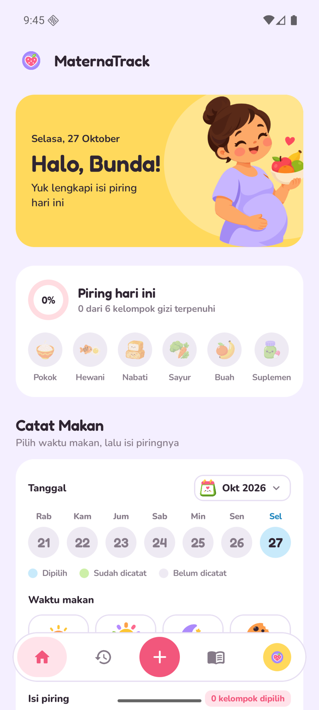
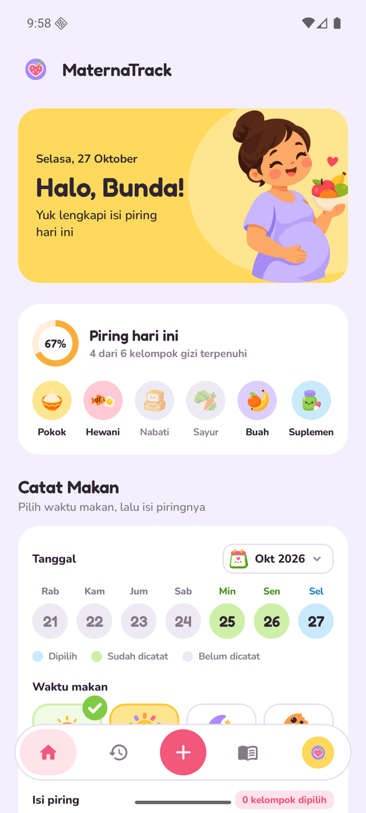
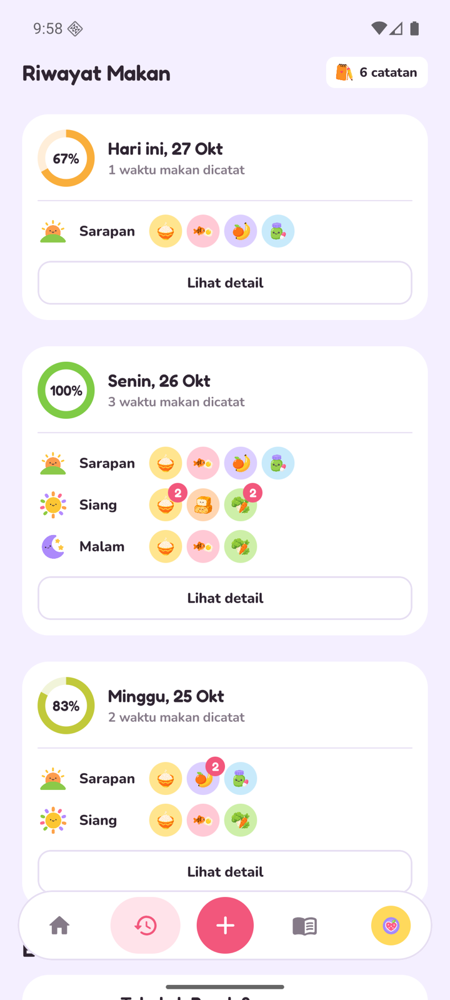
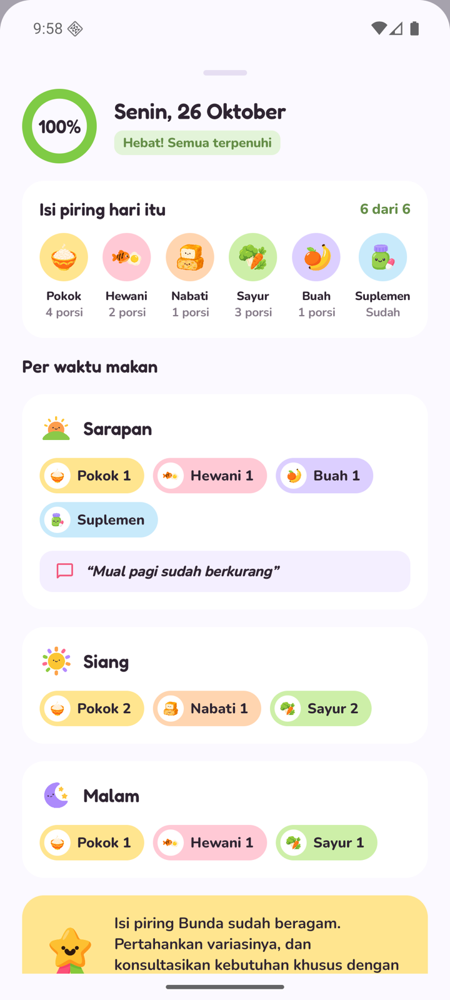
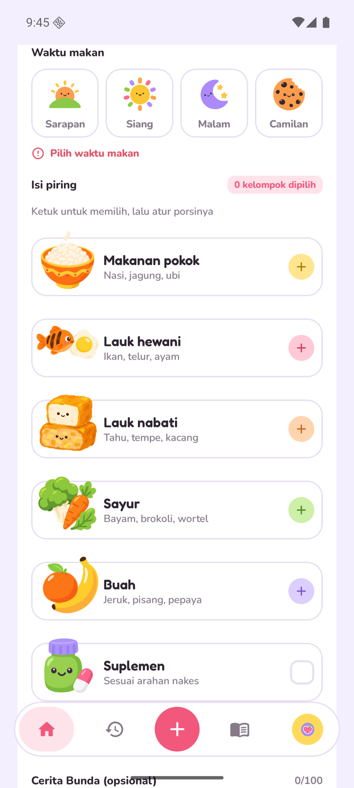
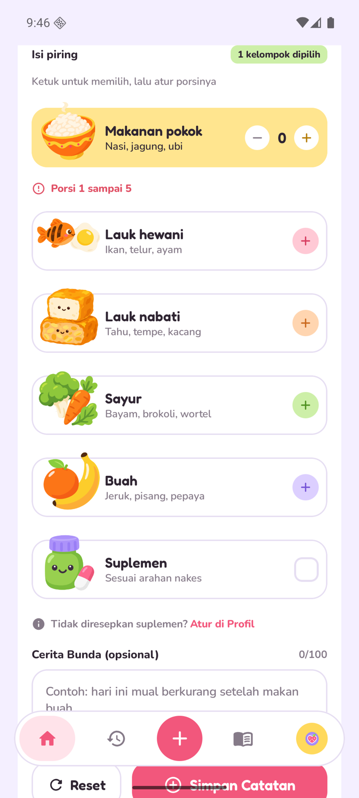
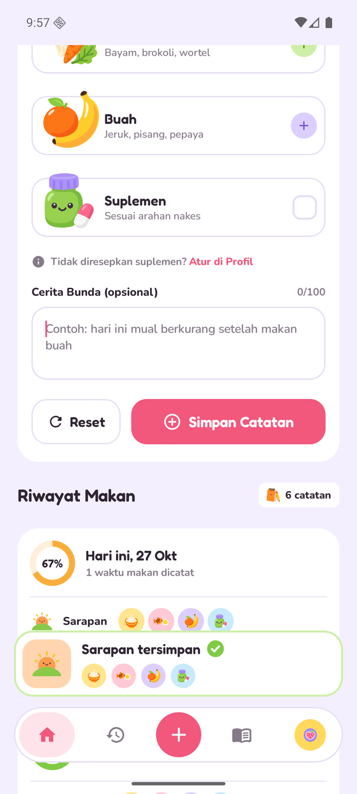
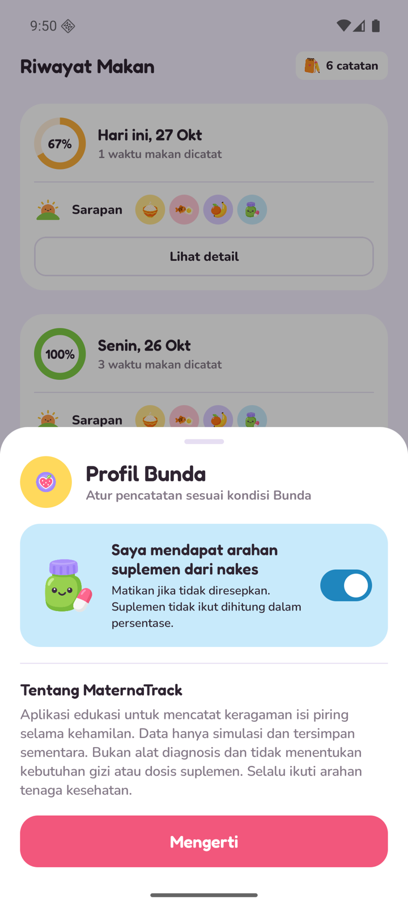
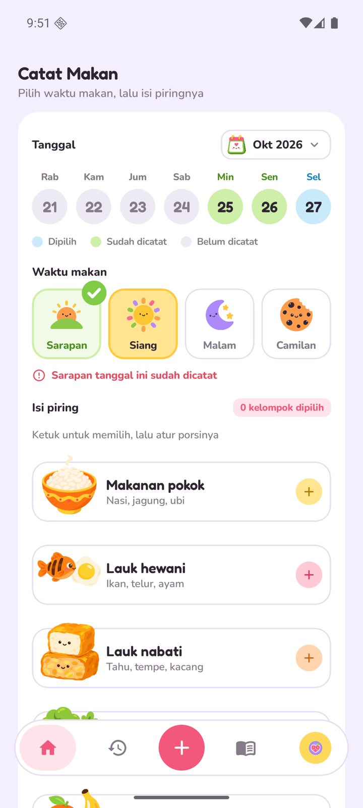
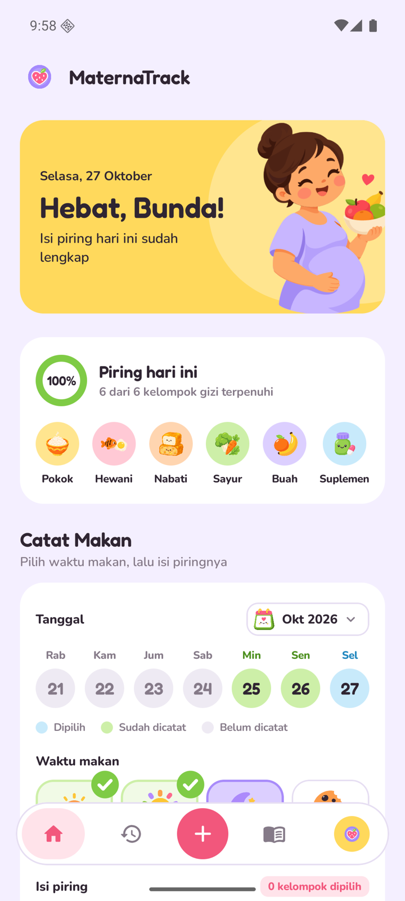

# MaternaTrack

**Studi kasus 6 | HT-06 — Edukasi gizi ibu hamil**
Proyek UTS Pemrograman Bergerak, Program Studi Sistem Informasi, Universitas Ma Chung.

MaternaTrack adalah aplikasi Android satu layar untuk mencatat checklist edukatif keragaman isi piring (Isi Piringku) dan suplemen selama kehamilan. Data hanya simulasi dan tersimpan sementara selama aplikasi berjalan.

<p>
  
  
  
  
</p>

## Masalah

Ibu hamil dianjurkan makan beragam: makanan pokok, lauk hewani, lauk nabati, sayur, dan buah, ditambah suplemen jika diarahkan tenaga kesehatan. Tanpa catatan, sulit melihat kelompok mana yang sudah atau belum terpenuhi dalam sehari. MaternaTrack membantu mencatat isi piring per waktu makan dan menunjukkan kelengkapannya secara visual, disertai pesan edukatif umum.

## Pengguna sasaran

- Ibu hamil / calon ibu
- Kader kesehatan
- Peserta edukasi maternal

## Fitur (UTS)

| Fitur | Keterangan |
|---|---|
| Checklist kelompok makanan dan suplemen | 5 kelompok makanan dengan porsi (stepper − / +, angka bisa diketik) dan suplemen (centang) |
| Validasi tanggal dan input | Pesan kesalahan di bawah field, layar menggulir ke field pertama yang salah, field bergetar |
| Daftar catatan harian sementara | `LazyColumn`, satu kartu per tanggal berisi baris per waktu makan |
| Jumlah komponen terpenuhi dan persentase | Kartu "Piring hari ini" (cincin persen + 6 bubble kelompok) dan cincin per hari di riwayat |
| Pesan edukatif umum | Kartu "Tahukah Bunda?" menyesuaikan kelompok yang belum terpenuhi hari ini |
| Detail hari | Lembar bawah: total porsi per kelompok, catatan per waktu makan, cerita Bunda |
| Profil Bunda | Switch "Saya mendapat arahan suplemen dari nakes"; jika mati, suplemen tidak dihitung |
| Umpan balik | Toast "Sarapan tersimpan", confetti dan "Hebat, Bunda!" saat isi piring hari ini lengkap |
| Floating navbar | Tab menggulir ke Beranda / Riwayat / Edukasi, tombol + ke form, logo membuka Profil |

## Model data

```kotlin
enum class WaktuMakan(val label: String, val bolehBerulang: Boolean)       // SARAPAN, SIANG, MALAM, CAMILAN
enum class KelompokMakanan(val label: String, val labelPendek: String, val contoh: String)
    // POKOK, HEWANI, NABATI, SAYUR, BUAH

data class CatatanMakan(
    val id: Long,
    val tanggal: LocalDate,
    val waktu: WaktuMakan,
    val porsi: Map<KelompokMakanan, Int>,   // hanya kelompok yang dipilih, nilai 1..5
    val minumSuplemen: Boolean,
    val cerita: String                      // opsional, maks 100 karakter
)

data class RingkasanHarian(
    val tanggal: LocalDate,
    val catatan: List<CatatanMakan>,
    val kelompokTerpenuhi: Set<KelompokMakanan>,
    val suplemenTerpenuhi: Boolean,
    val jumlahTerpenuhi: Int,
    val jumlahKomponen: Int,                // 6, atau 5 jika tidak ada arahan suplemen
    val persentase: Int,
    val status: StatusHarian                // MULAI, KURANG, HAMPIR, LENGKAP
)
```

Pemetaan ke data yang diminta studi kasus:

| Elemen data | Di aplikasi |
|---|---|
| Tanggal | `tanggal` (strip 7 hari + dialog kalender) |
| Kelompok makanan | `porsi[POKOK]` |
| Sayur dan buah | `porsi[SAYUR]`, `porsi[BUAH]` |
| Sumber protein | `porsi[HEWANI]`, `porsi[NABATI]` |
| Status suplemen sesuai arahan tenaga kesehatan | `minumSuplemen` + pengaturan arahan suplemen di Profil |
| Catatan | `cerita` ("Cerita Bunda (opsional)") |

## Logika

Semua logika berupa fungsi Kotlin murni di `app/src/main/java/com/maternatrack/app/logic/` dan diuji unit test.

- **Gabungan harian** (`ringkasanHari`): kelompok terpenuhi = gabungan kelompok dari semua waktu makan di tanggal itu (`Set`, tanpa duplikat). Suplemen terpenuhi jika ada catatan dengan `minumSuplemen` dan Bunda mendapat arahan suplemen.
- **Persentase**: `terpenuhi × 100 / komponen`, dibulatkan. Komponen = 6 (5 kelompok + suplemen) atau 5 jika tidak ada arahan suplemen.
- **Klasifikasi status** (`statusDari`): 0% Belum ada isi piring, 1–59% Yuk dilengkapi, 60–99% Sedikit lagi lengkap, 100% Hebat! Semua terpenuhi.
- **Ringkasan**: persentase dan "n dari 6 kelompok gizi terpenuhi" hari ini, jumlah catatan makan, total porsi per kelompok di detail hari. Semua dihitung ulang otomatis (`derivedStateOf`) saat data berubah.
- **Pesan edukasi** (`pesanEdukasi`): berdasar kelompok pertama yang belum terpenuhi (sayur, buah, protein, pokok), selalu disertai "Info edukasi umum, bukan saran medis."

## Validasi

| Field | Aturan | Pesan |
|---|---|---|
| Tanggal | Tidak boleh setelah hari ini (kalender juga menonaktifkannya) | Tanggal tidak boleh di masa depan |
| Waktu makan | Wajib dipilih | Pilih waktu makan |
| Waktu makan | Sarapan/Siang/Malam hanya sekali per tanggal (Camilan boleh berulang) | Sarapan tanggal ini sudah dicatat |
| Isi piring | Minimal satu kelompok atau suplemen | Pilih minimal satu isi piring |
| Porsi | Wajib diisi | Porsi wajib diisi |
| Porsi | Harus bilangan bulat | Porsi harus berupa angka |
| Porsi | Tidak boleh negatif | Porsi tidak boleh negatif |
| Porsi | 1 sampai 5 (batas konteks pencatatan, bukan target gizi) | Porsi 1 sampai 5 |
| Cerita | Maksimal 100 karakter (dibatasi saat mengetik) | — |

Porsi disimpan sebagai `String` di state form, lalu diperiksa dengan `toIntOrNull()`, sehingga ketikan huruf tidak membuat aplikasi crash.

## Struktur proyek

```
app/src/main/java/com/maternatrack/app/
  MainActivity.kt              satu Activity, memanggil MaternaTrackScreen
  model/Model.kt               enum dan data class
  logic/                       Ringkasan, Validasi, Edukasi, Tanggal (Kotlin murni)
  ui/MaternaTrackScreen.kt     satu layar: semua state + LazyColumn
  ui/components/               komponen Compose (form, kartu, sheet, navbar)
  ui/theme/                    warna, font, tema Material 3
app/src/test/                  unit test JUnit untuk logic/
docs/                          wireframe, desain, screenshot, test case
```

## Cara menjalankan

1. Buka folder proyek ini di Android Studio (versi terbaru), tunggu Gradle sync selesai.
2. Jalankan konfigurasi `app` di emulator atau HP Android 8.0 (API 26) ke atas.

Lewat terminal:

```bash
./gradlew assembleDebug          # APK di app/build/outputs/apk/debug/app-debug.apk
./gradlew testDebugUnitTest      # unit test logika
./gradlew installDebug           # pasang ke emulator/HP yang terhubung
```

Teknologi: Kotlin, Jetpack Compose (BOM 2026.02.01), Material 3, AGP 9.4.1, Gradle 9.6.0, minSdk 26, targetSdk 37.

## Screenshot

| | | |
|---|---|---|
|  |  |  |
| Kondisi awal | Validasi form kosong | Porsi di luar batas |
|  |  |  |
| Toast setelah simpan | Riwayat per hari | Detail hari |
|  |  |  |
| Profil Bunda | Waktu makan sudah dicatat | Isi piring hari ini lengkap |

Wireframe: [`docs/wireframe.png`](docs/wireframe.png), wireframe lain di [`docs/wireframe/`](docs/wireframe), file desain [`docs/design/maternatrack.pen`](docs/design/maternatrack.pen).

## Hasil uji

- 8 skenario pengujian minimum + 6 skenario tambahan: semua **lulus**. Rincian di [`docs/test-cases.md`](docs/test-cases.md).
- 24 unit test (`RingkasanTest` 10, `ValidasiTest` 9, `EdukasiTest` 5): semua **lulus**.

## Batasan UTS

- Data tersimpan sementara di memori (`mutableStateListOf`); hilang saat aplikasi ditutup.
- Satu Activity dan satu layar; tab navbar hanya menggulir ke bagian layar.
- Belum bisa mengubah atau menghapus catatan.
- Pengaturan arahan suplemen berlaku untuk semua hari, termasuk hari sebelumnya.
- Nama hari dan bulan di dalam dialog kalender mengikuti bahasa perangkat.
- Aplikasi bersifat edukatif: tidak menentukan kebutuhan energi, dosis suplemen, atau diagnosis risiko kehamilan.

## Rencana UAS

- Room Database dan CRUD lengkap (ubah dan hapus catatan).
- Beberapa layar: Beranda, Riwayat (filter tanggal, rekap mingguan dengan grafik batang), Detail, dan Edukasi (materi singkat per kelompok makanan). Desainnya sudah ada di [`docs/wireframe/uas-riwayat.png`](docs/wireframe/uas-riwayat.png) dan [`docs/wireframe/uas-edukasi.png`](docs/wireframe/uas-edukasi.png).

## Dokumen lain

- [CONTRIBUTIONS.md](CONTRIBUTIONS.md) — kontribusi tiap anggota
- [AI_USAGE.md](AI_USAGE.md) — penggunaan AI
- [PRESENTATION.md](PRESENTATION.md) — alur presentasi dan demo

> Batas keselamatan dan etika: aplikasi memakai data simulasi dan tidak menggantikan tenaga kesehatan.
